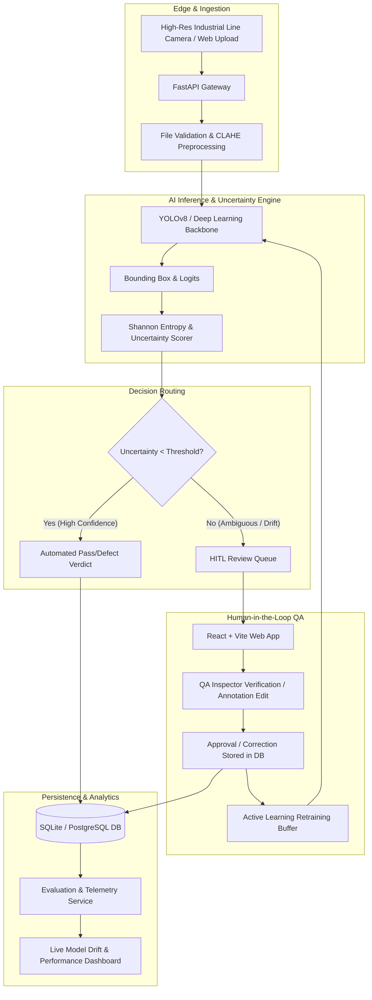

# 🏗️ FabricGuard-AI System Architecture

This document describes the high-level system architecture, data flow, active learning loop, and design principles of **FabricGuard-AI**.

---

## 1. System Components

### 1.1 Ingestion & Preprocessing Pipeline
- **Contrast-Limited Adaptive Histogram Equalization (CLAHE)**: Emphasizes subtle yarn defects without amplifying sensor noise across varying fabric dyes.
- **Aspect-Preserving Normalization**: Resizes images to $640 \times 640$ pixels for optimal YOLO tensor shapes with letterboxing.
- **Integrity Validation**: Magic-byte MIME verification rejects malicious payloads before passing data to computer vision buffers.

### 1.2 Inference & Uncertainty Estimation
Standard deep learning vision models often make overconfident mistakes on novel textile textures or lighting fluctuations. FabricGuard-AI couples object detection with Shannon entropy-based uncertainty quantification:

$$H(p) = - \sum_{i=1}^{C} p_i \log_2(p_i)$$

Where:
- $p_i$ is the softmax probability of class $i$ across $C$ candidate defect categories.
- When $H(p) > \tau_{\text{uncertainty}}$, or if the boundary regression score variance exceeds acceptable bounds, the sample is automatically flagged for human review.

### 1.3 Human-in-the-Loop (HITL) Review Panel
Borderline inspections are pushed to an asynchronous triage queue:
- QA operators inspect the original fabric texture with toggleable overlays.
- Operators can approve, reject false alarms, adjust bounding box coordinates, or reclassify the defect.
- Corrected samples are tagged for active learning retraining sets.

### 1.4 REST API & Database
- Built with **FastAPI** leveraging async I/O.
- Relational schema with **SQLAlchemy** storing inspections, bounding box coordinates, reviewer feedback, and batch sessions.

